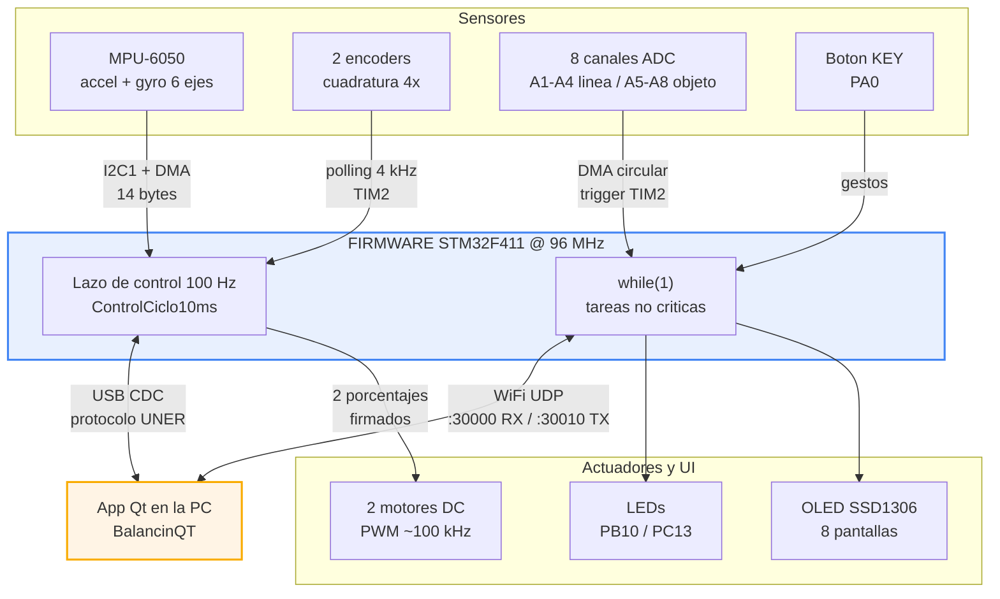
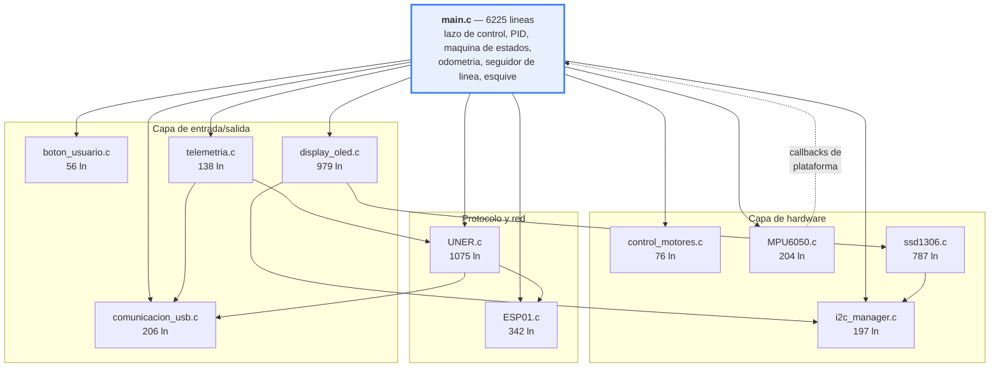
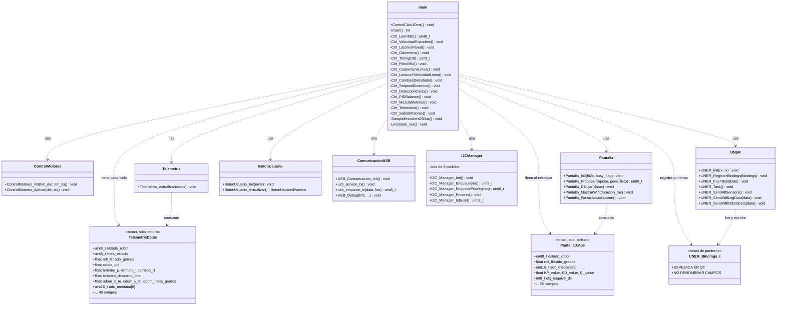
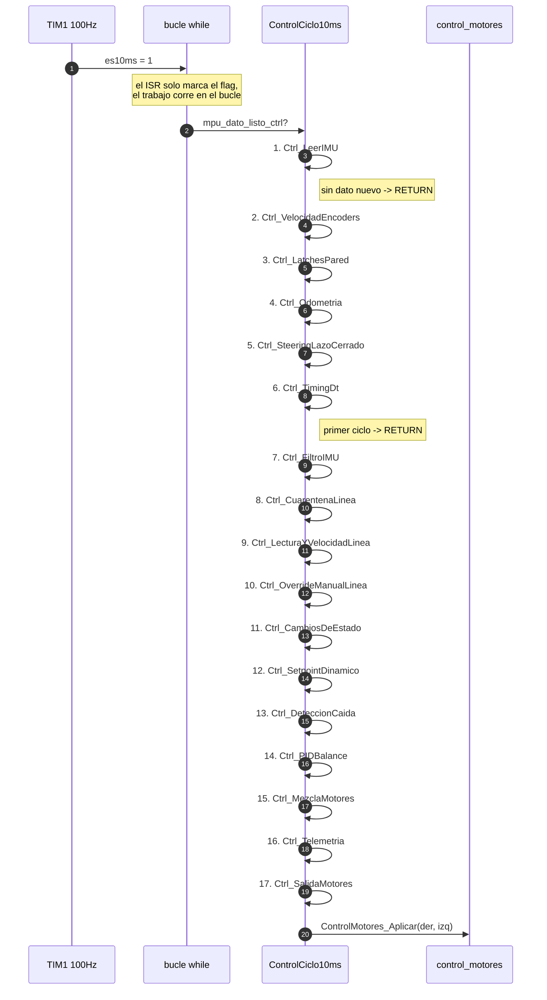
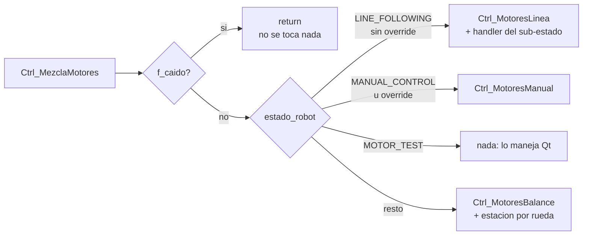
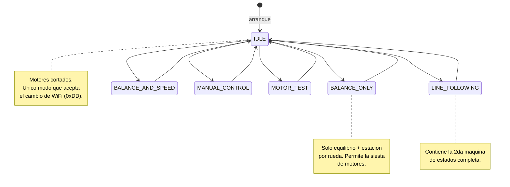
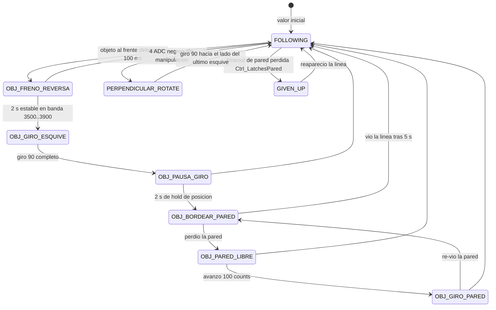
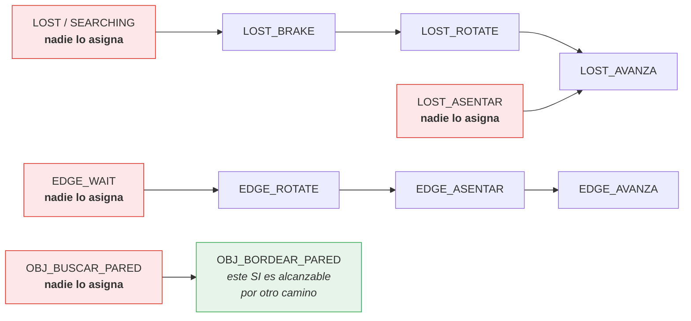
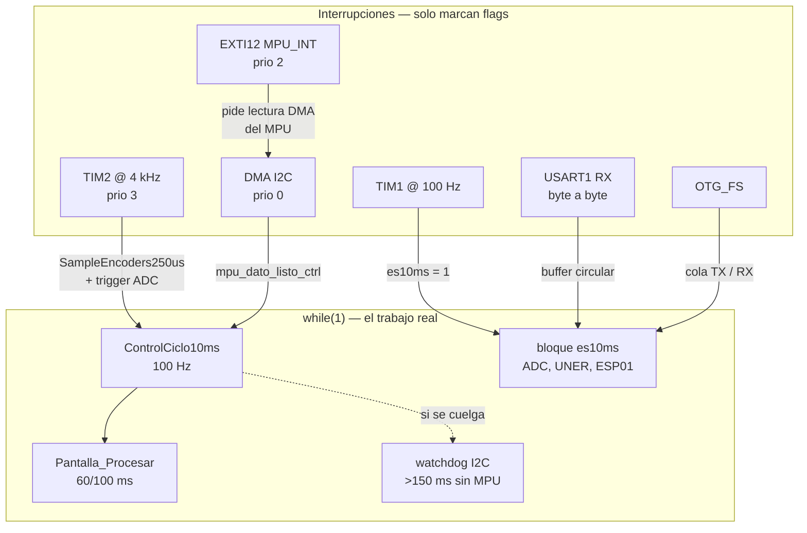
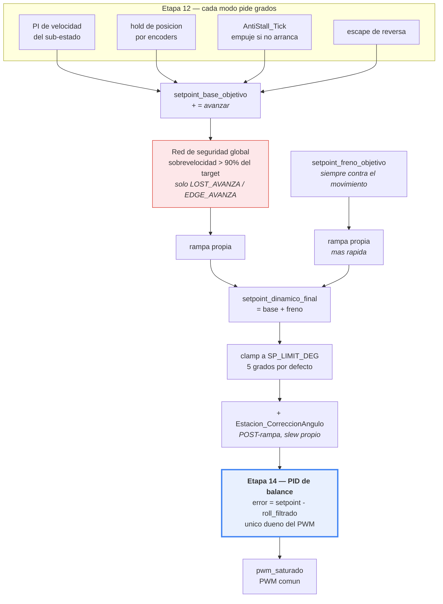

# Arquitectura del Firmware — Balancín Mendelevich

> Mapa visual del firmware para estudiarlo. Los diagramas están en Mermaid:
> GitHub los renderiza solo, y en VS Code con la extensión "Markdown Preview Mermaid".
> **Fuente de verdad = el código.** Si algo acá no coincide, el código gana.

Índice:
1. [Diagrama de contexto](#1-diagrama-de-contexto) — el firmware y el mundo exterior
2. [Módulos](#2-módulos-diagrama-de-paquetes) — quién depende de quién
3. [UML de módulos](#3-uml-de-módulos-y-estructuras) — APIs y structs
4. [El ciclo de control de 10 ms](#4-el-ciclo-de-control-de-10-ms) — las 17 etapas
5. [Las dos máquinas de estados](#5-las-dos-máquinas-de-estados)
6. [Interrupciones y tiempos](#6-interrupciones-y-tiempos)
7. [La cadena del setpoint](#7-la-cadena-del-setpoint) — cómo se arma el ángulo final
8. [Lo que hay que tener en cuenta](#8-lo-que-hay-que-tener-en-cuenta)

---

## 1. Diagrama de contexto

Qué entra, qué sale y con quién habla el firmware.



**Los dos canales con Qt no son lo mismo:**

| | USB CDC | WiFi UDP |
|---|---|---|
| Transporte | USB OTG FS, clase CDC | ESP-01 por USART1, AT commands |
| Protocolo | UNER binario | UNER binario (el mismo) |
| Telemetría | CSV a ~20 Hz | `WifiLogData_t` a ~10 Hz + `WifiOdomData_t` a 2 Hz |
| Siempre disponible | sí | solo si conectó |

**Modo WiFi:** Station por defecto (se conecta a tu router, perfil en `WIFI_PERFIL_ACTIVO`)
o SoftAP (el robot crea la red `Balancin`, IP 192.168.4.1) — se elige con KEY al encender
o con el comando `0xDD` desde Qt con el robot en IDLE.

---

## 2. Módulos (diagrama de paquetes)

`main.c` es el **controlador**: tiene todas las decisiones. Los módulos son **capas finas**
que solo traducen a hardware o formatean datos. Las flechas van en el sentido de la dependencia.



**La regla de diseño que explica todos los límites:** los módulos no toman decisiones de
control. `control_motores.c` recibe dos porcentajes y los convierte a CCR — no sabe qué es
un PID. `telemetria.c` recibe una foto de solo lectura (`TelemetriaDatos`) y la formatea —
no puede escribir nada del control. `display_oled.c` recibe `const PantallaDatos *`.

Esto tiene una consecuencia práctica: **para entender el comportamiento del robot solo
necesitás leer `main.c`.** Los módulos son plomería.

**La flecha punteada** `MPU6050.c -.-> main.c` es la única inversión: el driver del IMU
recibe punteros a funciones (`mpu_writeReg`, `mpu_readReg`, `mpu_readRegDMA`, `mpu_delayMs`,
`mpu_errorCb`) que viven en `main.c`. Es inyección de dependencias para que el driver no
conozca el HAL de ST.

---

## 3. UML de módulos y estructuras

C no tiene clases, así que modelo cada módulo como una "clase" con su API pública y las
structs que cruzan los límites.



**El punto más delicado del diagrama:** `UNER_Bindings_t` es una struct de **punteros** a las
variables de control. Qt manda `MODIFY_KP` y UNER escribe directo en `KP_value` a través del
puntero. Sus nombres de campo están **espejados en el proyecto Qt** — renombrar uno rompe la
app sin que el compilador diga nada.

---

## 4. El ciclo de control de 10 ms

`ControlCiclo10ms()` es un **orquestador**: 17 etapas en orden fijo, cada una una función
`Ctrl_*`. No hay lógica suelta, solo la secuencia y dos puertas de salida temprana.



### Qué hace cada etapa

| # | Etapa | Entrada → Salida |
|---|---|---|
| 1 | `Ctrl_LeerIMU` | ¿hay dato nuevo del MPU? + métrica de manipulación |
| 2 | `Ctrl_VelocidadEncoders` | counts acumulados → `velocidad_est_ema`, rps por rueda |
| 3 | `Ctrl_LatchesPared` | ADC lateral → latches de reversa, atorado, timeout |
| 4 | `Ctrl_Odometria` | encoders + gyro Z → pose `x, y, θ` |
| 5 | `Ctrl_SteeringLazoCerrado` | PID de dirección por encoders **(apagado hoy)** |
| 6 | `Ctrl_TimingDt` | `dt` real entre muestras (**solo telemetría**) |
| 7 | `Ctrl_FiltroIMU` | accel + gyro → `roll_filtrado_grados` (filtro complementario) |
| 8 | `Ctrl_CuarentenaLinea` | sensores de línea clavados → los saca de la cuenta |
| 9 | `Ctrl_LecturaYVelocidadLinea` | 4 ADC → centroide `linea_error` + velocidad deseada |
| 10 | `Ctrl_OverrideManualLinea` | comandos manuales mientras no ve la línea |
| 11 | `Ctrl_CambiosDeEstado` | entrar/salir de cada modo → qué resetear |
| 12 | `Ctrl_SetpointDinamico` | **el modo decide cuántos grados inclinarse** |
| 13 | `Ctrl_DeteccionCaida` | histéresis de caída/recuperación |
| 14 | `Ctrl_PIDBalance` | error de ángulo → `pwm_saturado` (PWM común) |
| 15 | `Ctrl_MezclaMotores` | elige rama: línea / manual / balance |
| 16 | `Ctrl_Telemetria` | arma CSV USB + paquetes WiFi |
| 17 | `Ctrl_SalidaMotores` | zona muerta, siesta, "en el aire" → PWM real |

La etapa 15 despacha según el modo:



---

## 5. Las dos máquinas de estados

Son **dos niveles anidados**: `estado_robot` elige el modo de operación, y dentro del modo
línea, `linea_estado` lleva una segunda máquina de 20 sub-estados.

### 5.1 Modo del robot — `estado_robot`



Los cambios de modo vienen de Qt (comandos UNER) o de gestos del botón KEY.
Cualquier modo puede caer a IDLE por caída (`f_caido`) o por corte de velocidad.

### 5.2 Sub-estados del modo línea — `linea_estado`

El `enum` declara 20 sub-estados y el `switch` despachador tiene un `case` para cada uno.
**Pero solo 9 son alcanzables.** Los otros 11 no los escribe nadie, directa ni
indirectamente — ver [5.3](#53-los-11-sub-estados-inalcanzables).

Esta es la máquina **que corre de verdad**:



Tres detalles que no se ven en el diagrama:

1. **Las entradas no vienen de los handlers.** `LineState_Following()` **no tiene ninguna
   transición**: la detección de objeto y la de cruce perpendicular las decide
   `Ctrl_LecturaYVelocidadLinea` (etapa 9), y el `GIVEN_UP` lo decide `Ctrl_LatchesPared`
   (etapa 3). Los handlers `LineState_*` solo manejan las transiciones *internas* de cada
   secuencia.
2. **`OBJ_PAUSA_GIRO` salta directo a `OBJ_BORDEAR_PARED`**, saltando `OBJ_BUSCAR_PARED`.
3. **Cualquier estado vuelve a `FOLLOWING`** por caída (`Ctrl_DeteccionCaida`), por cambio de
   modo (`Ctrl_CambiosDeEstado`) o desde las ramas manual/balance de la mezcla de motores.

**El esquive alterna de lado** en cada objeto: `obj_esquive_dir` vale `+1` (gira a la derecha,
bordea con ADC7) o `-1` (espejado: izquierda, ADC5). Los umbrales y mecanismos son los mismos
en ambos sentidos — solo cambian el signo de los pivots y el sensor lateral
(`OBJ_PARED_ADC_INDICE`).

### 5.3 Los 11 sub-estados inalcanzables

> ⚠️ **Hallazgo, pendiente de decisión.** Verificado estáticamente sobre el árbol actual:
> ninguna de las 45 asignaciones de `linea_estado` escribe estos 5 valores, nadie toma la
> dirección de la variable (`&linea_estado` no aparece), no es escribible desde Qt (no está
> en `UNER_Bindings_t`) y ningún otro `.c` la escribe. Por lo tanto son inalcanzables, y con
> ellos cae toda la cadena que dependía de ellos.

**Nunca asignados (5):**

| Estado | Handler que queda sin ejecutarse |
|---|---|
| `LINE_STATE_LOST` | `LineState_Lost()` |
| `LINE_STATE_SEARCHING` | *(cae por fallthrough en el mismo `case`)* |
| `LINE_STATE_LOST_ASENTAR` | `LineState_LostAsentar()` |
| `LINE_STATE_EDGE_WAIT` | `LineState_EdgeWait()` |
| `LINE_STATE_OBJ_BUSCAR_PARED` | `LineState_ObjBuscarPared()` |

**Inalcanzables en cascada (6)** — se asignan, pero solo desde estados inalcanzables:



**Qué implica en la práctica:** toda la recuperación de línea perdida —el **giro de 180°**
(`LOST_*`) y el **giro de 90° por el borde** (`EDGE_*`), con su retorno por odometría al punto
de pérdida— **no se ejecuta nunca**. Cuando el robot pierde la línea hoy, `linea_estado` se
queda en `FOLLOWING` y lo único que actúa es la rama `else` de `LineState_Following` más el
freno de la etapa 12.

Eso explica por qué varias de esas features figuran en el `CLAUDE.md` como *"pendiente validar
en el robot"* desde julio y nunca se validaron.

**No es una regresión reciente:** revisé `5206501` (2026-07-01) y ya entonces nada asignaba
`LOST` ni `EDGE_WAIT` desde `FOLLOWING` — la cadena era circular (`LOST → LOST_BRAKE → ... →
LOST`, sin puerta de entrada). Viene de antes de los refactors de septiembre.

**Las tres opciones**, para decidir con el robot delante:

1. **Conectarla**: agregar en `Ctrl_LecturaYVelocidadLinea` la transición
   `FOLLOWING → LOST_BRAKE` cuando `linea_perdida_ms` supere un umbral. Es la puerta que falta
   — un solo `if`. Riesgo: son ~700 líneas de código que **nunca corrieron en el robot**.
2. **Borrarla**: ~700 líneas y ~40 defines menos. Recuperable del historial de git.
3. **Dejarla y documentarla**: lo que hace este archivo. Cuesta 0 y no rompe nada.

---

## 6. Interrupciones y tiempos

Cuatro ritmos distintos corriendo a la vez. **Ninguna ISR hace trabajo pesado**: marcan un
flag y el `while(1)` lo procesa.



| Fuente | Frecuencia | Prio NVIC | Qué hace |
|---|---|---|---|
| **DMA I2C** | — | **0** (la más alta) | completa la lectura del MPU |
| **EXTI12** (MPU_INT) | ~100 Hz | 2 | dato listo → pide lectura DMA |
| **TIM2** | 4 kHz | 3 | muestrea encoders + dispara ADC |
| **TIM1** | 100 Hz | — | marca `es10ms` |
| USART1 RX | por byte | — | recibe del ESP-01 |
| OTG_FS | por paquete | — | USB CDC |

**Por qué el DMA de I2C está en prioridad 0:** antes empataba en 1 con `EXTI15_10` y la
transacción I2C quedaba pendiente en cola durante ráfagas → freeze. Esas prioridades están
forzadas en `USER CODE BEGIN 2` porque **CubeMX las resetea a 0 en cada regeneración**.

**El watchdog de software** es la red de seguridad: si pasan >150 ms sin dato del MPU, llama
`I2C1_Recover()` (9 pulsos de SCL + re-init) **sin resetear el micro**. Se detecta por
`"I2C RECOVER"` en el USB.

---

## 7. La cadena del setpoint

Esto es **el corazón del diseño** y lo que más cuesta ver leyendo el código salteado: el
seguidor de línea, el esquive y el manual **no tocan los motores**. Solo mueven el setpoint
de inclinación, y el PID de balance conserva siempre la autoridad final.



**Por qué `base` y `freno` van separados:** cada uno tiene su propia rampa, y el freno tiene
que poder entrar **más rápido** que el avance. Si fueran una sola variable, la rampa lenta del
avance frenaría también al freno y llegaría tarde justo cuando más se necesita.

**Por qué la estación entra POST-rampa:** cuando viajaba dentro de `setpoint_base_objetivo`,
la rampa de 0.1°/ciclo + la EMA de velocidad le metían ~150 ms de retraso — la D llegaba en
contrafase y **bombeaba** el vaivén en vez de amortiguarlo. Por eso subir la ganancia siempre
empeoraba. Hoy se aplica al final con su propio slew de 0.4°/ciclo.

**La cascada completa**, de afuera hacia adentro:

```
sensores de linea  ->  PID de linea      ->  ajuste_direccion   (canal DIFERENCIAL)
velocidad deseada  ->  PI de velocidad   ->  grados de setpoint
                                                    |
                                                    v
                       PID de balance    ->  pwm_saturado       (canal COMUN)
                                                    |
                                                    v
                       mezcla: comun +- diferencial ->  2 motores
```

El de línea decide **hacia dónde**, el PI de velocidad decide **cuánto inclinarse**, y el PID
de balance decide **cuánto PWM**. Nadie salta de nivel.

---

## 8. Lo que hay que tener en cuenta

### Convenciones de signo (la fuente de la mitad de las confusiones)

| Variable | Convención |
|---|---|
| `velocidad_est_ema` | **negativo = adelante** |
| `setpoint_base_objetivo` | **positivo = avanzar** |
| `ajuste_direccion` | positivo → rueda derecha más lenta → gira a la derecha |
| `obj_esquive_dir` | `+1` derecha / `-1` izquierda |
| `AntiStall_Tick` | devuelve **siempre positivo**, el signo lo pone quien llama |

### Atomicidad al leer los dos encoders

Las ISR de TIM2 escriben los counts a 4 kHz. Siempre que se leen **las dos ruedas juntas**:

```c
__disable_irq();
int32_t a = encoder_derecho   - ancla_der;
int32_t b = encoder_izquierdo - ancla_izq;
__enable_irq();
float resultado = (a + b) * 0.5f;   // las cuentas AFUERA
```

No es por atomicidad de cada lectura — en Cortex-M4 un `int32_t` alineado se lee en una
instrucción y no se puede partir. Es por **coherencia entre las dos**: si la ISR cae en el
medio, tenés la derecha en `t` y la izquierda en `t+250µs`.

### Piso de cuantización de los encoders

Con `ENCODER_COUNTS_POR_VUELTA = 28` y delta de counts cada 10 ms:

- 1 count en **una** rueda ≈ **0.32 m/s**
- 1 count en **ambas** ≈ 0.63 m/s

Por eso `FRENO_VEL_ZONA_MUERTA = 0.35` — filtra exactamente ese piso. **Nada que necesite
resolución por debajo de 0.32 m/s es confiable**, y por eso la odometría sirve para volver a
un punto pero no para precisión fina.

### El contrato con Qt (romper esto no da error de compilación)

| Qué | Dónde | Consecuencia |
|---|---|---|
| Campos de `UNER_Bindings_t` | `UNER.h` | Qt escribe por puntero → **nunca renombrar** |
| Layout de `WifiLogData_t` | `UNER.h` | hay un mirror packed en `mainwindow.h` |
| Layout de `WifiOdomData_t` | `UNER.h` | ídem |
| Valores del enum `line_state` | `robot_estados.h` | **el orden importa**: viaja como número |
| Puertos UDP 30000 / 30010 | `ESP01_StartUDP` | |
| Rangos de los clamps | `UNER.c` | si Qt permite más, el firmware recorta **en silencio** |

**Renombrar un enum es seguro, reordenarlo no.** Todos los renombres de `FWD`/`SETTLE` que
se hicieron conservaron el orden justamente por esto.

### Al regenerar con CubeMX

1. Nunca tocar fuera de `/* USER CODE BEGIN */` ... `/* USER CODE END */`
2. Hacer **commit antes** de abrir el `.ioc`
3. Después, `git diff` obligatorio: CubeMX borra `EXTI9_5_IRQHandler` y simplifica
   `EXTI15_10_IRQHandler`, y **resetea las prioridades NVIC a 0**

### Mecanismos apagados o degradados

| Qué | Estado |
|---|---|
| `Ctrl_SteeringLazoCerrado` + `ComputeSteeringPID` | `direccion_pid_habilitado` está **hardcodeado en 0**: corre 100 veces por segundo solo para escribir `0.0f`. Feature apagada, no residuo |
| `roll_accel_filtrado` | se envía en el CSV pero **solo se asigna al recuperarse de una caída** → el dato que ves en Qt está congelado |
| `MODIFY_BETA_G/A` (0xBC/0xBD) | vestigiales: los betas son defines fijos, el firmware responde UNKNOWN |
| TIM5 | inicializado pero nunca arrancado (era el re-habilitador de EXTI de encoders) |
| `dt_real` (etapa 6) | **solo telemetría**: el control usa `DT_CTRL_FIJO` siempre |
| 11 de los 20 sub-estados de línea | **inalcanzables** — toda la recuperación de línea perdida (180° y 90°). Ver [5.3](#53-los-11-sub-estados-inalcanzables) |

### Por dónde empezar a leer

```
1. ControlCiclo10ms        las 17 etapas en orden -> el esqueleto
2. Ctrl_PIDBalance         el unico que toca el PWM
3. Ctrl_SetpointDinamico   la mas larga; es un switch gigante por sub-estado
4. Ctrl_LecturaYVelocidadLinea   el centroide, la velocidad deseada, y las
                                 UNICAS dos entradas a sub-estados de linea
5. LineState_ObjFrenoReversa en adelante -> la secuencia de esquive, que es
                                 la unica cadena de sub-estados que corre
```

Dos reglas para no perderse:

- **En `Ctrl_SetpointDinamico`, cada rama solo escribe `setpoint_base_objetivo` y
  `setpoint_freno_objetivo`.** Si una rama no te interesa, salteala entera: no hay efectos
  cruzados.
- **De los 19 handlers `LineState_*`, solo 9 se ejecutan.** Antes de estudiar uno, chequeá
  en [5.3](#53-los-11-sub-estados-inalcanzables) si su estado es alcanzable — te ahorrás
  leer ~700 líneas de código que hoy no corre.
