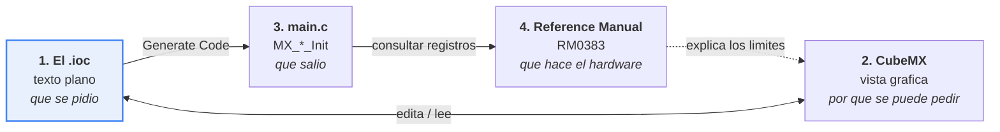
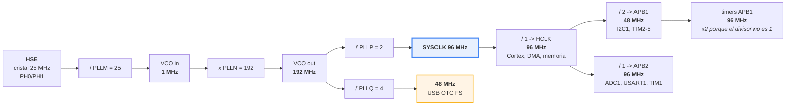
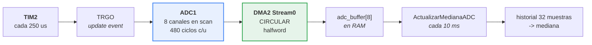
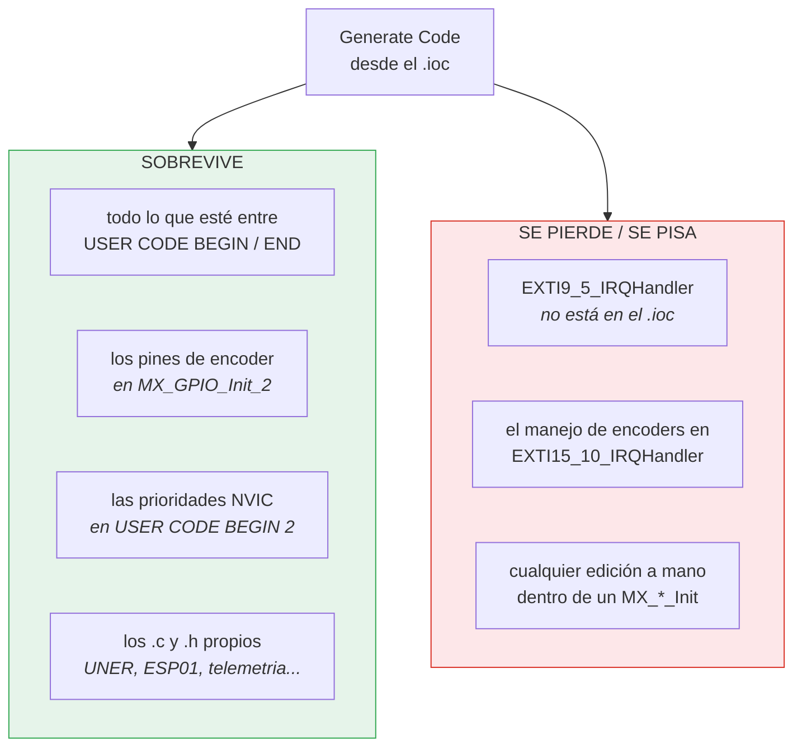

# El `.ioc` explicado — Balancín Mendelevich

> Guía para estudiar `Balancin_Mendelevich.ioc` a fondo. Cada valor del archivo,
> qué significa, de dónde sale y qué línea de código genera.
> Complemento de [ARQUITECTURA.md](ARQUITECTURA.md), que explica el software.

Índice:
1. [Qué es el `.ioc` y cómo se lee](#1-qué-es-el-ioc-y-cómo-se-lee)
2. [Cómo estudiarlo: las tres vistas](#2-cómo-estudiarlo-las-tres-vistas)
3. [El árbol de reloj](#3-el-árbol-de-reloj) — de 25 MHz a 96 MHz
4. [Los cinco timers](#4-los-cinco-timers) — con la cuenta de cada frecuencia
5. [La cadena del ADC](#5-la-cadena-del-adc) — TIM2 → ADC → DMA circular
6. [Los tres streams de DMA](#6-los-tres-streams-de-dma)
7. [NVIC: la trampa de los ceros](#7-nvic-la-trampa-de-los-ceros)
8. [Mapa de pines](#8-mapa-de-pines) — y los cuatro que NO están
9. [ProjectManager](#9-projectmanager) — stack, heap, versión del HAL
10. [Qué pasa al regenerar](#10-qué-pasa-al-regenerar)
11. [Discrepancias encontradas](#11-discrepancias-encontradas)

---

## 1. Qué es el `.ioc` y cómo se lee

Es un archivo de **texto plano**, 345 líneas, formato `clave=valor`. No es binario, no
es XML: lo podés abrir con cualquier editor y versionarlo en git como cualquier fuente.

**La relación con el código es de una sola dirección:**

```
Balancin_Mendelevich.ioc   ──(Generate Code)──>   MX_*_Init() en main.c
     ↑ la FUENTE                                        ↓ el RESULTADO
  esto se edita                              esto NO se edita a mano
```

Si editás `MX_TIM2_Init()` a mano, la próxima regeneración te lo borra. Lo que se toca es
el `.ioc` (desde CubeMX, o el texto si sabés lo que hacés).

### La sintaxis, en tres reglas

**Regla 1 — el prefijo antes del primer punto es el "dueño" del valor:**

```
TIM2.Period=249              → el periférico TIM2
RCC.HSE_VALUE=25000000       → el árbol de reloj
PB10.GPIO_Label=LED_BLINKER  → el pin PB10
Dma.ADC1.2.Instance=...      → el DMA, request #2, que es del ADC1
ProjectManager.StackSize=... → el proyecto, no el chip
```

**Regla 2 — `IPParameters` es el índice de ese periférico.** Lista qué parámetros se
guardaron. Si un parámetro no está en `IPParameters`, CubeMX usa el valor por defecto
aunque haya una línea suelta con ese valor:

```
TIM2.IPParameters=Prescaler,Period,TIM_MasterOutputTrigger
TIM2.Period=249
TIM2.Prescaler=95
TIM2.TIM_MasterOutputTrigger=TIM_TRGO_UPDATE
```

Los tres parámetros listados están, y nada más. Todo lo demás de TIM2 (modo de cuenta,
auto-reload preload, etc.) queda en el default del HAL.

**Regla 3 — la barra invertida escapa espacios y `#`:**

```
ADC1.Channel-0\#ChannelRegularConversion=ADC_CHANNEL_1
PH0\ -\ OSC_IN.Signal=RCC_OSC_IN
TIM3.Channel-PWM\ Generation1\ CH1=TIM_CHANNEL_1
```

Eso se lee `Channel-0#ChannelRegularConversion`, `PH0 - OSC_IN` y
`Channel-PWM Generation1 CH1`. Es ruido de serialización, no significado.

### Las secciones, por tamaño

| Prefijo | Líneas | Qué contiene |
|---|---|---|
| `Mcu.*` | 55 | el chip: modelo, encapsulado, lista de periféricos y pines usados |
| `Dma.*` | 34 | los 3 streams de DMA con todos sus parámetros |
| `ADC1.*` | 33 | 8 canales, rangos, tiempos de muestreo, trigger |
| `ProjectManager.*` | 32 | toolchain, versión del HAL, stack, heap, rutas |
| `RCC.*` | 30 | el árbol de reloj completo |
| `NVIC.*` | 28 | qué interrupciones están habilitadas y con qué prioridad |
| `SH.*` | 26 | *shared signals*: qué señal usa cada pin compartido |
| `TIM1..5`, `P??`, resto | ~107 | timers, pines, I2C, USART, USB |

---

## 2. Cómo estudiarlo: las tres vistas

El `.ioc` solo se entiende cruzando **tres fuentes a la vez**. Es la parte que más cuesta
al principio: ninguna de las tres te da el cuadro completo.



**El método que funciona, periférico por periférico:**

1. **Abrí el `.ioc` en CubeMX** (doble click en STM32CubeIDE). La pestaña *Pinout &
   Configuration* te muestra lo mismo que el texto, pero con los **rangos válidos** y los
   conflictos marcados en rojo. Eso es lo que el texto no te dice.
2. **Buscá el periférico en el texto** con el prefijo (`grep "^TIM2\." *.ioc`). Ahí ves
   exactamente qué se guardó y qué quedó en default.
3. **Buscá su `MX_*_Init()` en `main.c`** y compará línea por línea. Lo que está en el
   código y no en el `.ioc` es un **default del HAL**, y es justo lo que se te escapa
   leyendo solo el `.ioc`.
4. **Para entender *por qué* un valor y no otro**, el Reference Manual **RM0383** (el del
   STM32F411) tiene el diagrama de bloques de cada periférico. El datasheet solo da pines
   y características eléctricas; los registros están en el RM.

Comandos útiles para el paso 2:

```bash
grep "^RCC\." Balancin_Mendelevich.ioc        # el reloj
grep -E "^TIM[0-9]\." Balancin_Mendelevich.ioc # los timers
grep -E "^P[A-H][0-9]+" Balancin_Mendelevich.ioc | sort   # los pines
```

**Una advertencia práctica:** abrir el `.ioc` en CubeMX y guardarlo —aunque no cambies
nada— puede reordenar líneas y actualizar la versión del generador. Hacé **commit antes**,
y si el `git diff` sale enorme sin que hayas tocado nada, sabés por qué.

---

## 3. El árbol de reloj

El cristal es de **25 MHz** y el micro corre a **96 MHz**. En el medio hay un PLL.



Los valores salen de `RCC.*` en el `.ioc` y se materializan en `SystemClock_Config()`:

| `.ioc` | Código | Valor |
|---|---|---|
| `RCC.HSE_VALUE=25000000` | `RCC_OSCILLATORTYPE_HSE` | cristal de 25 MHz |
| `RCC.PLLM=25` | `PLL.PLLM = 25` | divisor de entrada |
| `RCC.VCOInputFreq_Value=1000000` | — *(derivado)* | 25 / 25 = **1 MHz** |
| `RCC.VCOOutputFreq_Value=192000000` | `PLL.PLLN = 192` | 1 × 192 = **192 MHz** |
| `RCC.SYSCLKFreq_VALUE=96000000` | `PLL.PLLP = RCC_PLLP_DIV2` | 192 / 2 = **96 MHz** |
| `RCC.PLLQCLKFreq_Value=48000000` | `PLL.PLLQ = 4` | 192 / 4 = **48 MHz** |
| `RCC.APB1CLKDivider=RCC_HCLK_DIV2` | `APB1CLKDivider` | 96 / 2 = **48 MHz** |
| *(default)* | `APB2CLKDivider = RCC_SYSCLK_DIV1` | **96 MHz** |

### Las cuatro restricciones que explican estos números

1. **El USB necesita exactamente 48 MHz.** No 47.9. De ahí sale `PLLQ=4`, y eso fuerza a
   que el VCO sea múltiplo de 48 → 192 MHz. **Si querés cambiar la velocidad del micro,
   el USB es el que manda.**
2. **El VCO debe quedar entre 100 y 432 MHz.** 192 cumple.
3. **APB1 no puede pasar de 50 MHz** en el F411 → de ahí el `/2`. APB2 aguanta 100 → `/1`.
4. **A 96 MHz la Flash necesita 3 *wait states*** → `FLASH_LATENCY_3` en el código.
   Ponerle menos cuelga el micro de forma errática, no con un error claro.

### El detalle que confunde: los timers de APB1 corren al DOBLE

APB1 va a 48 MHz, **pero los timers de APB1 van a 96 MHz**:

```
RCC.APB1Freq_Value=48000000       ← los periféricos (I2C1)
RCC.APB1TimFreq_Value=96000000    ← los TIMERS del mismo bus
```

Es una regla del silicio: **si el divisor de APB no es 1, los timers de ese bus reciben
×2.** Está en el RM0383. Por eso TIM2, TIM3, TIM4 y TIM5 cuentan a 96 MHz y no a 48 — y
si usás 48 en la cuenta, te sale el doble de la frecuencia real.

> ⚠️ `RCC.VCOInputMFreq_Value=1562500` (25/16) está en el archivo pero **no se usa**: es
> un residuo de cuando `PLLM` valía 16. `IPParameters` lo lista, así que CubeMX lo
> conserva, pero `PLLM=25` es el que manda.

**Nota de diseño:** con VCO input en 1 MHz estás en el **mínimo** del rango recomendado
(ST sugiere 1-2 MHz, idealmente 2) — da un poco más de jitter de PLL. Con un cristal de
25 MHz y necesitando 192 MHz de VCO, `PLLM=25` es la única opción entera, así que no hay
nada que mejorar acá.

---

## 4. Los cinco timers

Todos cuelgan de un reloj de **96 MHz** (TIM1 por APB2 directo; TIM2-5 por el ×2 de APB1).

La fórmula es siempre la misma:

```
frecuencia = 96 MHz / (Prescaler + 1) / (Period + 1)
```

El `+1` es porque los registros cuentan **desde 0**. Olvidarlo es el error clásico.

| Timer | `.ioc` | La cuenta | Resultado | Para qué |
|---|---|---|---|---|
| **TIM1** | `Prescaler=9599`<br/>`Period=99` | 96e6 / 9600 / 100 | **100 Hz** | marca `es10ms`: el lazo de control |
| **TIM2** | `Prescaler=95`<br/>`Period=249`<br/>`TRGO=UPDATE` | 96e6 / 96 / 250 | **4 kHz** | muestrea encoders **+ dispara el ADC** |
| **TIM3** | `Prescaler=0`<br/>`Period=959` | 96e6 / 1 / 960 | **100 kHz** | PWM motor derecho (CH1, CH2) |
| **TIM4** | `Prescaler=0`<br/>`Period=959` | 96e6 / 1 / 960 | **100 kHz** | PWM motor izquierdo (CH1, CH2) |
| **TIM5** | `Prescaler=95`<br/>`Period=1999` | 96e6 / 96 / 2000 | 500 Hz | **nunca se arranca** — residuo |

### Lo que hay que entender de cada uno

**TIM1 — por qué un prescaler tan grande.** Para bajar de 96 MHz a 100 Hz hacen falta
960.000 cuentas, y el registro es de 16 bits (máximo 65.535). No alcanza con uno solo, así
que se parte en dos factores: 9600 × 100. Cualquier par que multiplique 960.000 sirve.

**TIM2 — hace dos trabajos.** La interrupción de update dispara `SampleEncoders250us()`,
y el **mismo** evento de update sale por TRGO hacia el ADC. Eso es lo que significa
`TIM_MasterOutputTrigger=TIM_TRGO_UPDATE`: *"cuando el contador desborda, avisale a otro
periférico"*. Por eso encoders y ADC van perfectamente en fase, gratis, sin código.

**TIM3/TIM4 — `Period=959` es la resolución, no solo la frecuencia.** Con 960 pasos de
cuenta, el duty tiene **960 niveles** (0 a 959). El código habla en porcentaje -100..100 y
`control_motores.c` hace la regla de tres a CCR. Bajar `Period` subiría la frecuencia pero
te dejaría con menos pasos de duty.

**Por qué 100 kHz y no 20 kHz:** arriba de ~20 kHz el motor no chilla (fuera del rango
audible). 100 kHz además da una respuesta de corriente más suave. El costo es que el
driver tiene que poder conmutar así de rápido.

**TIM5 — residuo.** Era el que re-habilitaba las EXTI de los encoders en el esquema viejo.
Se inicializa (`MX_TIM5_Init()`) pero **nunca se le hace `HAL_TIM_Base_Start_IT`**, así
que no genera interrupciones. Está en el `.ioc` y se podría sacar; se dejó porque quitarlo
no gana nada y toca el `.ioc`.

---

## 5. La cadena del ADC

Esta es la parte más elegante de la configuración y la que más conviene entender: **los 8
sensores se leen solos, sin una sola línea de código en el lazo de control.**



Lo que dice el `.ioc`, traducido:

| Clave | Valor | Significado |
|---|---|---|
| `ExternalTrigConv` | `ADC_EXTERNALTRIGCONV_T2_TRGO` | **no** arranca por software: lo dispara TIM2 |
| `ContinuousConvMode` | `DISABLE` | una secuencia por trigger, no a rienda suelta |
| `NbrOfConversion` | `8` | los 8 canales en una sola pasada (*scan mode*) |
| `Rank-0..7` | `1..8` | el **orden** del barrido |
| `Channel-0..7` | `ADC_CHANNEL_1..8` | qué canal en cada puesto |
| `SamplingTime-0..7` | `ADC_SAMPLETIME_480CYCLES` | **el máximo posible** |
| `DMAContinuousRequests` | `ENABLE` | el DMA sigue pidiendo sin re-armar |
| `EOCSelection` | `ADC_EOC_SEQ_CONV` | avisa al terminar la **secuencia**, no cada canal |

Y lo que **no** está en el `.ioc` pero sí en el código generado (defaults del HAL):

```c
hadc1.Init.ClockPrescaler = ADC_CLOCK_SYNC_PCLK_DIV4;   // 96/4 = 24 MHz
hadc1.Init.Resolution     = ADC_RESOLUTION_12B;         // 0..4095
hadc1.Init.ScanConvMode   = ENABLE;
hadc1.Init.DataAlign      = ADC_DATAALIGN_RIGHT;
```

### La cuenta de tiempos (y por qué cierra justo)

```
reloj del ADC   = APB2 / 4 = 96 / 4      = 24 MHz   (máximo permitido: 36 MHz)
por canal       = 480 muestreo + 12 conversión = 492 ciclos
                = 492 / 24 MHz           = 20,5 us
secuencia de 8  = 8 x 20,5               = 164 us
ventana de TIM2 =                          250 us
```

**Usa el 66% de la ventana.** Entra, pero no sobra tanto: si subieras el `Period` del ADC
—o pusieras más canales— se te solapan las secuencias.

**Por qué 480 ciclos y no 15:** los sensores de línea son reflectivos con **impedancia de
salida alta**. El ADC tiene que cargar su capacitor de muestreo a través de esa impedancia,
y con poco tiempo de muestreo la lectura sale baja y ruidosa. 480 ciclos (20 µs) le dan
tiempo de sobra. Es el valor correcto para este hardware, no un descuido.

**El modo CIRCULAR del DMA es lo que hace que no haga falta código:** al llegar al byte 8
vuelve al 0 y sigue. El buffer siempre tiene las 8 lecturas más frescas, se lea cuando se
lea. El lazo de control nunca espera al ADC — solo mira la RAM.

Encima de eso, `ActualizarMedianaADC()` guarda 32 muestras por canal y toma la **mediana**
(no el promedio) para rechazar los picos de EMI de los motores. Un promedio no los
rechazaría: un solo pico lo arrastra.

---

## 6. Los tres streams de DMA

```
Dma.Request0=I2C1_RX   → DMA1_Stream0
Dma.Request1=I2C1_TX   → DMA1_Stream1
Dma.Request2=ADC1      → DMA2_Stream0
```

| Stream | Para | Dirección | Modo | Alineación |
|---|---|---|---|---|
| **DMA1_Stream0** | I2C1 RX | periférico → memoria | `NORMAL` | byte |
| **DMA1_Stream1** | I2C1 TX | memoria → periférico | `NORMAL` | byte |
| **DMA2_Stream0** | ADC1 | periférico → memoria | **`CIRCULAR`** | **halfword** |

Las tres diferencias que importan:

- **`NORMAL` vs `CIRCULAR`**: el I2C transfiere una vez y para (hay que re-armarlo en cada
  lectura del MPU — eso lo hace `i2c_manager.c`). El ADC no para nunca.
- **byte vs halfword**: el I2C mueve bytes; el ADC devuelve 12 bits, que no caben en un
  byte → `uint16_t`. Si esto estuviera mal, leerías basura.
- **`MemInc=ENABLE` en los tres**: la dirección de memoria avanza (es un array).
  `PeriphInc=DISABLE`: el registro del periférico es siempre el mismo.

**El stream no se elige libremente.** Cada petición de DMA está cableada en silicio a
streams y canales concretos: el ADC1 solo puede usar DMA2 Stream0 o Stream4. La tabla está
en el RM0383, y CubeMX la respeta por vos — por eso conviene cambiar esto desde la GUI y
no editando el texto.

---

## 7. NVIC: la trampa de los ceros

Mirá lo que dice el `.ioc` para **todas** las interrupciones:

```
NVIC.DMA1_Stream0_IRQn=true:0:0:false:false:true:false:true:true
NVIC.DMA2_Stream0_IRQn=true:0:0:false:false:true:false:true:true
NVIC.EXTI15_10_IRQn=true:0:0:false:false:true:true:true:true
NVIC.TIM2_IRQn=true:0:0:false:false:true:true:true:true
                   ↑ ↑
         prioridad ─┘ └─ sub-prioridad
```

El formato es `habilitada : prioridad : subprioridad : ...`. **Todas dicen `0:0`** —
o sea, **el `.ioc` cree que todo tiene la máxima prioridad.** Y con todo en 0 no hay
jerarquía: ninguna interrupción puede interrumpir a otra.

**Las prioridades reales están forzadas en el código**, en `USER CODE BEGIN 2` dentro de
`main()`:

```c
HAL_NVIC_SetPriority(DMA1_Stream0_IRQn, 0, 0);  // I2C1 RX DMA  ← la más alta
HAL_NVIC_SetPriority(DMA1_Stream1_IRQn, 0, 0);  // I2C1 TX DMA
HAL_NVIC_SetPriority(DMA2_Stream0_IRQn, 2, 0);  // ADC1 DMA
HAL_NVIC_SetPriority(EXTI15_10_IRQn,    2, 0);  // MPU (PB12)
HAL_NVIC_SetPriority(TIM2_IRQn,         3, 0);  // encoders
HAL_NVIC_SetPriority(TIM5_IRQn,         6, 0);  // libre
```

**Y funciona porque el orden de ejecución lo salva:**

```
main()
 ├── MX_GPIO_Init()   ← pone EXTI15_10 en prio 0   (del .ioc)
 ├── MX_DMA_Init()    ← pone los DMA en prio 0     (del .ioc)
 ├── ... el resto de los MX_*_Init()
 └── USER CODE BEGIN 2
      └── los HAL_NVIC_SetPriority de arriba       ← PISAN los ceros
```

Los `MX_*_Init()` corren **primero** y el bloque de usuario **después**. Como
`USER CODE BEGIN 2` sobrevive a la regeneración, **las prioridades correctas sobreviven
también**. No es tan frágil como parece.

**Pero el riesgo real es otro:** si alguna vez borrás o movés ese bloque, o agregás una
interrupción nueva y te olvidás de darle prioridad, te queda silenciosamente en 0 — la
misma que el DMA del I2C. Y ese empate es exactamente la causa que está documentada del
freeze de I2C: con prioridades iguales, una ráfaga de interrupciones puede dejar la
transacción del I2C colgada en la cola.

**Regla para esta configuración:** la prioridad de una interrupción nueva se define en
`USER CODE BEGIN 2`, nunca en CubeMX. El `.ioc` no es la fuente de verdad acá.

Dos cosas más de esta sección:

- **`NVIC.PriorityGroup=NVIC_PRIORITYGROUP_4`**: los 4 bits de prioridad se usan todos
  para prioridad de grupo y **ninguno para sub-prioridad**. Por eso el segundo número de
  `HAL_NVIC_SetPriority` siempre es 0 — no hace nada.
- **`EXTI9_5_IRQn` no está en la lista.** Es el vector de PA8 (encoder derecho canal A), y
  por eso CubeMX borra su handler de `stm32f4xx_it.c` al regenerar. Hoy no importa porque
  los encoders se leen por polling, pero es el origen de esa advertencia del `CLAUDE.md`.

---

## 8. Mapa de pines

Lo que **sí** está declarado en el `.ioc`:

| Pin | `Signal` | Extra | Función en el robot |
|---|---|---|---|
| PA0-WKUP | `GPIO_Input` | `GPIO_PuPd=PULLUP`, `Locked` | botón KEY |
| PA1..PA7 | `ADCx_IN1..IN7` | `PA1` Locked | sensores 1-7 |
| PB0 | `ADCx_IN8` | `Locked` | sensor 8 |
| PA9 / PA10 | `USART1_TX` / `RX` | `Mode=Asynchronous` | ESP-01 |
| PA11 / PA12 | `USB_OTG_FS_DM` / `DP` | `Mode=Device_Only` | USB a Qt |
| PA13 / PA14 | `SYS_JTMS-SWDIO` / `JTCK-SWCLK` | `Mode=Serial_Wire` | **debug SWD** |
| PB2 | `GPIO_Output` | `Locked` | CH_PD del ESP-01 |
| PB4 / PB5 | `S_TIM3_CH1` / `CH2` | | PWM motor derecho |
| PB6 / PB7 | `S_TIM4_CH1` / `CH2` | | PWM motor izquierdo |
| PB8 / PB9 | `I2C1_SCL` / `SDA` | `Mode=I2C`, `Locked` | MPU + OLED |
| PB10 | `GPIO_Output` | `GPIO_Label=LED_BLINKER`, `PinState=RESET` | LED |
| PB12 | `GPXTI12` | `GPIO_Label=MPU_INT`, `Locked` | data-ready del IMU |
| PC13-ANTI_TAMP | `GPIO_Output` | `Locked` | LED integrado |
| PH0 / PH1 | `RCC_OSC_IN` / `OUT` | `Mode=HSE-External-Oscillator` | cristal 25 MHz |

Tres cosas a notar:

- **`GPIO_Label` genera los `#define`.** `PB10.GPIO_Label=LED_BLINKER` es lo que produce
  `LED_BLINKER_Pin` y `LED_BLINKER_GPIO_Port` en `main.h`. Los pines sin label hay que
  escribirlos a mano (`GPIO_PIN_13`, `GPIOC`).
- **`Locked=true`** le dice a CubeMX *"no muevas este pin al reasignar"*. Es una
  protección contra que te cambie un pin solo al agregar un periférico.
- **PA13/PA14 son el SWD.** No los toques nunca: sin ellos perdés la capacidad de
  debuggear y flashear por ST-Link.

### Los cuatro pines que NO están en el `.ioc`

> ⚠️ **PA8, PB13, PB14 y PB15 — los encoders — no aparecen en el `.ioc`.**
> Verificado: `grep -cE "^PA8|^PB13|^PB14|^PB15"` devuelve **0**.

Se configuran a mano, dentro del bloque de usuario de `MX_GPIO_Init()`:

```c
/* USER CODE BEGIN MX_GPIO_Init_2 */
GPIO_InitStruct.Pin  = GPIO_PIN_8;                             // encoder derecho A
GPIO_InitStruct.Mode = GPIO_MODE_INPUT;
GPIO_InitStruct.Pull = GPIO_PULLUP;
HAL_GPIO_Init(GPIOA, &GPIO_InitStruct);

GPIO_InitStruct.Pin  = GPIO_PIN_13 | GPIO_PIN_14 | GPIO_PIN_15;  // der B, izq A, izq B
GPIO_InitStruct.Mode = GPIO_MODE_INPUT;
GPIO_InitStruct.Pull = GPIO_PULLUP;
HAL_GPIO_Init(GPIOB, &GPIO_InitStruct);
/* USER CODE END MX_GPIO_Init_2 */
```

**La buena noticia:** está en `USER CODE`, así que **la regeneración no lo borra**. Los
encoders no se van a romper por abrir CubeMX.

**El riesgo real:** en la vista de pines de CubeMX, esos cuatro aparecen **libres**. Si
algún día habilitás un periférico que los quiera (TIM1_CH1 está en PA8, por ejemplo),
CubeMX te los va a asignar **sin avisarte de ningún conflicto** — porque desde su punto de
vista no hay conflicto. Y ahí sí se te rompen los encoders, con una regeneración que se
veía inocente.

**Mitigación recomendada:** marcarlos como `GPIO_Input` + `Locked` en CubeMX. Quedan
declarados en el `.ioc`, CubeMX los protege, y el código de `USER CODE` sigue funcionando
igual (reconfigurar un pin dos veces con los mismos valores es inofensivo). Son 4 clicks
y eliminan toda esta clase de problema.

---

## 9. ProjectManager

Esta sección **no describe el chip**, describe el proyecto. Dos valores importan de verdad:

| Clave | Valor | Por qué importa |
|---|---|---|
| `StackSize` | `0x400` = **1 KB** | ajustado. Un array local grande en una función te desborda la pila **sin error de compilación** |
| `HeapSize` | `0x200` = 512 B | el firmware no usa `malloc`, así que casi no se toca |
| `FirmwarePackage` | `STM32Cube FW_F4 V1.28.3` | **la versión del HAL**. Cambiarla cambia el código generado |
| `TargetToolchain` | `STM32CubeIDE` | genera `.cproject`/`.project` de Eclipse |
| `MainLocation` | `Core/Src` | dónde escribe `main.c` |
| `LibraryCopy` | `1` | copia el HAL al proyecto en vez de referenciarlo |
| `CoupleFile` | `false` | todo en `main.c`, sin `.c` por periférico |

**El stack de 1 KB explica una decisión de diseño del firmware.** La foto de datos del
display (`PantallaDatos`, ~50 campos) vive en **RAM estática** y no en la pila justamente
por esto: sumarle ~184 bytes al stack del dibujado, con 1 KB total, es jugar con fuego.

Si alguna vez tenés un *hard fault* raro al entrar a una función con muchos locales,
empezá por acá: `StackSize` a `0x800` (2 KB). El F411CE tiene 128 KB de RAM, así que
sobra lugar.

---

## 10. Qué pasa al regenerar



**El checklist, en orden:**

1. **Commit antes.** Siempre. Es la única red real.
2. Generar.
3. `git diff` y revisar **`stm32f4xx_it.c`** primero: ahí es donde desaparecen handlers.
4. Verificar que `USER CODE BEGIN 2` conserve los `HAL_NVIC_SetPriority`.
5. Compilar Debug **y** Release.

Si el diff sale gigante y no tocaste nada, probablemente CubeMX reordenó el `.ioc` o
actualizó su versión del generador. Revisá el diff del `.ioc` mismo para confirmarlo.

---

## 11. Discrepancias encontradas

Cosas que el `CLAUDE.md` dice y el `.ioc` contradice. Verificadas contra el archivo y
contra el código generado.

| Dónde | Dice | Es |
|---|---|---|
| Tabla de periféricos, ADC1 | "**15 ciclos**/canal" | **480 ciclos** (`ADC_SAMPLETIME_480CYCLES`, en el `.ioc` y en las dos líneas de `main.c`) |
| Tabla de periféricos, encoders | pines "Input pull-up simple" | correcto, **pero no están en el `.ioc`** — solo en `USER CODE` |
| Advertencias de CubeMX | "verificar que las prioridades no hayan sido reseteadas" | las reales están en `USER CODE BEGIN 2`, que **sobrevive**; el `.ioc` siempre tuvo 0 |

**La del ADC importa de verdad:** 15 ciclos darían una secuencia de 9 µs; 480 dan 164 µs.
Es un factor 18, y es la diferencia entre "sobra tiempo" y "usa dos tercios de la ventana
de 250 µs". Si alguien planifica agregar canales basándose en el 15, se le solapan las
conversiones.
